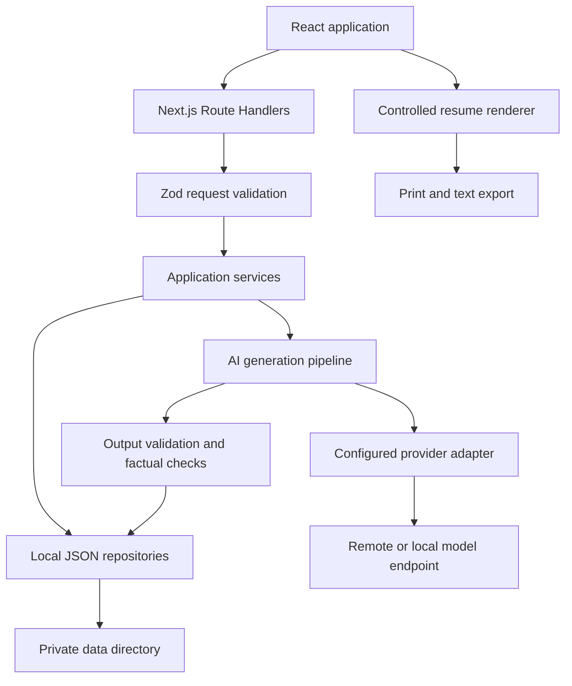

# Resumium implementation plan

This plan translates `AGENTS.md` into an actionable roadmap for a local resume builder using Next.js, React, Tailwind CSS, Zod, and configurable AI integrations. It describes proposed work; it does not indicate that these features have already been implemented.

## 1. Current state and implementation approach

The repository currently contains an early application scaffold:

| Area | Current state | Work needed |
| --- | --- | --- |
| Framework | Next.js 16.4.0, React 19.3.0, TypeScript | Verify the existing setup and establish a working application shell |
| Styling | Tailwind dependencies and a custom Turbopack CSS configuration | Verify compatibility and add application styles |
| Backend | `app/api/route.ts` returns `Hello, World!` | Implement validated application endpoints |
| Frontend | No application pages or root layout in the inspected source files | Build setup, profile, job, resume, and settings screens |
| Validation | Zod is required by `AGENTS.md` but is absent from `package.json` | Install it and define shared schemas |
| Persistence | No application storage layer | Implement local JSON repositories |
| AI | No provider configuration or integration | Introduce a provider interface and generation service |
| Tests | No test tooling or test scripts | Establish unit, integration, UI, and AI evaluation coverage |
| Documentation | README describes the project and technologies | Document installation, configuration, workflows, and recovery |

**Recommended approach:** first make profile storage, resume editing, and preview work without AI. Then add AI tailoring through a separate service. This gives us a usable foundation and makes provider failures easier to isolate.

The first complete workflow should be:

1. Start the application locally.
2. Load and validate `userData.json`.
3. Configure an AI provider and model using server-side credentials.
4. Paste a job description.
5. Generate a tailored resume draft.
6. Review the draft against the original career facts.
7. Edit, save, preview, and export the resume.

## 2. Scope and product decisions

### MVP scope

- One local user and one canonical career profile.
- A documented `userData.json` format, a fictional example file, and an in-app editor.
- Manual job-description entry with an optional role, company, and source link.
- One working AI integration behind a provider-neutral interface.
- Server-side environment configuration for credentials; settings UI for non-secret options.
- Structured AI-generated drafts with links back to supporting profile entries.
- Resume editing, section ordering, saved drafts, and generation metadata.
- One accessible, single-column resume template.
- Browser print/save-as-PDF and plain-text export.
- Offline profile editing, resume editing, and preview; AI availability depends on the configured provider.
- Automated validation, storage, API, AI failure, and end-to-end tests.

### Later iterations

Additional provider implementations, richer revision history, a fully local model integration if the first provider is remote, optional automated PDF generation, DOCX export, multiple templates, multilingual tailoring, and importing existing resumes can follow the first release.

Accounts, cloud synchronization, billing, collaboration, automatic job-site scraping, and automatic application submission are outside the initial scope.

### Decisions to establish before implementation

| Decision | Recommended initial choice | Reason |
| --- | --- | --- |
| Runtime | Single local Node.js process | Matches filesystem persistence and keeps deployment simple |
| User model | One profile per installation | Matches the current requirements |
| Canonical profile | `data/userData.json` | Preserves the requested filename and separates private data from source code |
| Credentials | Server-side `.env.local` | Avoids introducing a credential-writing UI in the first release |
| AI provider | Select one provider for the first working adapter | Prove the complete workflow before implementing several integrations |
| Generation | One bounded request with timeout and progress state | Avoids a persistent queue until generation duration justifies it |
| Resume format | Structured JSON rendered through a controlled template | Makes validation, editing, and export independent of generated markup |
| Export | Print/save-as-PDF plus plain text | Delivers useful exports with a small initial implementation |
| Deletion | Explicit UI action with confirmation and a documented recovery policy | Prevents accidental loss of career data and drafts |

Local storage means data is saved on the user's machine. A remote AI integration still sends selected profile information and the job description to that provider. Explain this during setup and before first generation. A local model can offer a different data boundary, but its actual network behavior must be verified.

ATS-oriented formatting is a design goal. Do not promise universal ATS compatibility, a guaranteed score, or hiring outcomes.

## 3. Proposed architecture

Keep HTTP handling, business logic, filesystem operations, provider calls, and rendering separate.



### Responsibilities

- **Route Handlers:** validate requests and route parameters, apply local access protections, call services, and return consistent responses.
- **Schemas:** define the persisted data, request payloads, provider configuration, and generated outputs. Infer TypeScript types from these schemas.
- **Services:** coordinate profile updates, job storage, generation, resume editing, and exports.
- **Repositories:** load, validate, write, and recover local files. They should not contain prompt-building or UI logic.
- **AI adapters:** translate the application contract into a provider's API and normalize responses and failures.
- **Resume renderer:** display validated resume data using application-owned components and styles.

Use server-only modules for storage and credentials. Never expose secrets through `NEXT_PUBLIC_` variables or include them in client component props.

### Proposed source layout

```text
app/
  layout.tsx
  page.tsx
  globals.css
  setup/page.tsx
  profile/page.tsx
  jobs/page.tsx
  resumes/page.tsx
  resumes/[id]/page.tsx
  settings/page.tsx
  api/
    health/route.ts
    profile/route.ts
    profile/validate/route.ts
    settings/route.ts
    ai/test/route.ts
    jobs/route.ts
    jobs/[id]/route.ts
    resumes/route.ts
    resumes/generate/route.ts
    resumes/[id]/route.ts
    resumes/[id]/export/route.ts
components/
  forms/
  profile/
  jobs/
  resumes/
  ui/
lib/
  schemas/
  services/
  storage/
  ai/
    providers/
    prompts/
  resume/
  api/
data/                       # Private runtime files; ignored by Git
examples/
  userData.example.json      # Fictional data; committed
tests/
  unit/
  integration/
  e2e/
  fixtures/
  evaluations/
docs/
  IMPLEMENTATION_PLAN.md
  data-format.md
  ai-providers.md
  api.md
```

This is a target layout, not a requirement to create every directory immediately. Add modules when their phase requires them.

### Next.js-specific implementation rules

The installed Next.js documentation is the version-specific authority, as required by `AGENTS.md`.

- Use App Router Route Handlers in `app/api/**/route.ts`; do not introduce a parallel Pages Router API layer.
- Use the Node.js runtime for handlers accessing the filesystem.
- Follow the installed documentation for asynchronous dynamic route parameters.
- Keep personal-data responses private and uncached; verify behavior under the existing `cacheComponents` setting.
- Review `agentFeedback`, `partialPrefetching`, and the custom CSS loader before depending on them. Retain only configuration that is supported and useful for this application.
- Test asynchronous Server Component flows through end-to-end tests where unit tooling does not support them.

## 4. Data contracts and schema design

Define schemas before forms and endpoints. This prevents the frontend, stored files, and AI prompts from developing different interpretations of the same data.

### Main entities

| Entity | Suggested fields | Purpose |
| --- | --- | --- |
| Career profile | `schemaVersion`, `revision`, `updatedAt`, `basics`, `experience`, `education`, `skills`, `projects`, `certifications`, `languages` | Canonical user-provided facts |
| Experience entry | Stable `id`, employer, role, location, start/end dates, achievements, technologies | Supports selection and traceability |
| Achievement | Stable `id`, factual description, optional user-provided metrics | Gives AI concrete evidence without inventing results |
| Job description | `id`, `revision`, role, company, raw text, optional source URL, timestamps | Preserves the actual input used for tailoring |
| AI settings | `schemaVersion`, provider, model, approved endpoint, supported generation options | Stores non-secret configuration |
| Resume | `id`, `revision`, title, job ID, source profile revision, content, section order, template, status, timestamps | Stores independently editable resume drafts |
| Generation metadata | Provider, model, prompt version, input snapshot references, warnings, duration, reported usage | Helps diagnose and compare generations |
| Generation evidence | Section/bullet references to profile entry or achievement IDs | Supports review of generated claims |

### Validation policy

Use shared Zod schemas for forms and backend input, but always validate again on the server. Zod supports structured validation results through `safeParse` and inferred TypeScript types through `z.infer`. See [Zod basic usage](https://zod.dev/basics).

- Validate every API body, route parameter, and supported query parameter.
- Validate JSON read from disk, not just JSON submitted through the UI.
- Validate provider output before rendering or saving it.
- Require bounded strings and arrays; establish explicit request and generation input limits.
- Validate email and URL formats while allowing absent optional fields.
- Use month-level dates such as `YYYY-MM` where career data does not have an exact day; validate actual month values and chronological ordering.
- Represent current employment explicitly, rather than with an invalid placeholder date.
- Use stable IDs rather than array positions as references.
- Distinguish an incomplete editable profile from a profile ready for generation.
- Reject unknown fields on API command payloads. Use versioned migrations for persisted formats instead of silently discarding unfamiliar data.
- Reject unsupported schema versions with a useful recovery message.

Do not require every optional resume section. A user with no certifications or projects should still be able to create a resume.

### Canonical facts and generated wording

The profile is the source of truth. Tailoring may select, reorder, summarize, and rephrase supported information, but it must not overwrite the profile or add unsupported employers, qualifications, dates, skills, or numerical achievements.

Generated drafts are separate documents. Editing a resume does not automatically update the profile, and changing the profile does not silently rewrite existing resumes.

Store an immutable snapshot of the generation inputs, or a reference to an immutable local snapshot, so later profile changes do not erase the evidence used for a draft. Document retention and deletion of these snapshots because they also contain personal data.

## 5. Filesystem persistence and local privacy

### Proposed runtime storage

```text
data/
  userData.json
  settings.json
  jobs/<id>.json
  resumes/<id>.json
  generations/<id>.json
  snapshots/<id>.json
  backups/
```

Use an application-controlled data directory, configurable through a server-side environment setting if necessary. Do not accept arbitrary filesystem paths from API requests.

### Storage behavior

1. Read and validate a file before returning domain data.
2. Validate updated data before saving it.
3. Write to a temporary file in the same directory, then replace the destination using a strategy verified on Windows and other supported systems.
4. Serialize application writes to the same resource.
5. Require an expected revision for updates and return a conflict when it is stale.
6. Detect out-of-band edits to `userData.json`, for example using a content hash in addition to its revision. Define how users reload or resolve the conflict.
7. Keep a bounded backup policy for successful saves and explain its storage and privacy implications.
8. Preserve malformed files and show actionable errors rather than silently resetting them.

An atomic replacement reduces the risk of partial files; it does not solve every concurrent-write problem. The initial support contract should allow one running application instance. External file edits and a second app process need explicit conflict detection or rejection.

### Privacy and access controls

- Add private data, backups, exports saved by the app, logs, and real credentials to `.gitignore`.
- Commit only fictional examples and a placeholder `.env.example`; make an explicit ignore exception for that example.
- Keep API keys out of `userData.json`, `settings.json`, API responses, logs, and exports.
- Bind documented local startup commands to loopback by default.
- Validate allowed Host/Origin values and protect mutating endpoints against cross-origin requests; loopback binding alone is insufficient protection.
- Use a local session/request token where appropriate, reject unexpected content types, and do not enable permissive CORS.
- Avoid shared or build-time caching of personal data.
- Render provider content as text through controlled components; do not execute generated HTML or Markdown.
- Restrict AI endpoint configuration to deliberate settings changes. Never let a job description choose an endpoint or trigger arbitrary network requests.
- Keep normal logs limited to error codes, timings, and non-sensitive identifiers.

Local files are not automatically encrypted. Describe protection provided by the user's operating system and disk setup accurately.

## 6. API contract

The empty API section in `AGENTS.md` should be populated as these routes are implemented. Keep a fuller reference with examples in `docs/api.md`.

| Method | Route | Responsibility |
| --- | --- | --- |
| GET | `/api/health` | Report application readiness without secrets or absolute storage paths |
| GET | `/api/profile` | Load the validated canonical profile and revision |
| PUT | `/api/profile` | Validate and replace the profile using an expected revision |
| POST | `/api/profile/validate` | Validate an imported JSON payload without saving it |
| GET | `/api/settings` | Return non-secret settings and configuration readiness |
| PUT | `/api/settings` | Update validated non-secret settings |
| POST | `/api/ai/test` | Run an explicit, minimal provider connection test without career data |
| GET, POST | `/api/jobs` | List or create saved job descriptions |
| GET, PUT, DELETE | `/api/jobs/[id]` | Read, update, or delete a job under a defined reference policy |
| GET, POST | `/api/resumes` | List resumes or create a manual draft |
| POST | `/api/resumes/generate` | Generate and persist a validated draft from server-loaded inputs |
| GET, PUT, DELETE | `/api/resumes/[id]` | Read, edit, or delete a resume |
| GET | `/api/resumes/[id]/export?format=txt` | Export a validated plain-text resume |

The MVP uses browser print/save-as-PDF from a print view. Add a PDF API option only if a later phase introduces server-generated PDFs.

### Request and response conventions

Generation requests should reference a saved job, expected input revisions, and bounded preferences such as language and target length. Load canonical data on the server and capture it before making the provider request. Do not trust a client-supplied profile as the current source of truth.

Successful JSON responses can use `{ data, meta }`. Errors should use a consistent shape:

```json
{
  "error": {
    "code": "VALIDATION_ERROR",
    "message": "Please correct the highlighted fields.",
    "fields": {
      "basics.email": ["Enter a valid email address."]
    }
  }
}
```

Define an explicit mapping for malformed JSON, schema errors, missing resources, revision conflicts, oversized input, provider rate limits, provider failures, timeouts, and storage failures. Never return raw stack traces, provider payloads, credentials, or sensitive filesystem paths.

Keep endpoints thin. Business services should be reusable and testable without an HTTP server.

## 7. AI integration and generation pipeline

### Provider abstraction

Define an interface around application needs, such as `testConnection()` and `generateStructuredResume(input, options)`. An adapter should describe its supported capabilities rather than pretending that all providers accept the same parameters.

Normalize authentication, endpoint configuration, model selection, timeouts, cancellation, structured-output behavior, usage reporting, and error categories. Implement one real adapter first and use a fake adapter for deterministic tests.

A second adapter should not require changes to profile storage, resume editing, or the renderer.

### Generation steps

1. Validate the request and local access context.
2. Load and validate the profile, job, and provider settings.
3. Check generation readiness and expected revisions.
4. Capture immutable input snapshots.
5. Build a bounded prompt with a version identifier.
6. Include career facts relevant to tailoring. Merge contact details from the profile locally when the model does not need them.
7. Treat the job description as untrusted content. It must not override application instructions, access files, use tools, or retrieve secrets.
8. Request structured output conforming to the resume schema; use native structured-output support where the chosen provider offers it.
9. Parse and validate the response with Zod.
10. Check source references, protected factual fields, duplicate sections, size limits, and unsupported additions that deterministic rules can detect.
11. If appropriate, make one bounded repair attempt for a malformed response. Do not loop indefinitely or silently make repeated billable requests.
12. Save only a valid draft, together with provenance, warnings, and generation metadata.
13. Return the draft for user review.

### Prompt requirements

- Select and emphasize facts relevant to the role.
- Use clear language and conventional section labels.
- Preserve employers, dates, qualifications, and supplied metrics.
- Do not invent achievements or insert unsupported keywords.
- Report missing relevant skills as gaps instead of claiming the user has them.
- Return source IDs for selected or rewritten achievements.
- Separate review notes and gaps from the actual resume content.
- Respect the requested language and reasonable length preference.

Source IDs and schema validation improve traceability but cannot prove that free-form wording is factually correct. The review screen must let the user compare generated claims with their supporting profile facts.

### Failure and cost behavior

Use finite timeouts, bounded retries for transient failures, input/output limits, cancellation where supported, and clear progress states. Keep local editing usable when a provider is unavailable.

Distinguish a successful provider response from a successfully persisted draft. If persistence fails after generation, make recovery possible without automatically paying for another generation. Avoid claiming exact costs unless reliable model pricing and reported usage are available.

## 8. User experience and resume output

### Screens and states

| Screen | Main behavior | Important states |
| --- | --- | --- |
| Setup | Explain data location, load/create profile, identify missing AI configuration | First run, invalid file, missing credentials, connection failure |
| Profile | Edit career facts, import/export JSON, display validation | Unsaved changes, incomplete profile, stale revision, save failure |
| Jobs | Paste and save job descriptions | Empty input, oversized input, saved job, edit conflict |
| Resume workspace | Generate, edit, order sections, compare with source facts | Loading, cancellation, failure, warnings, unsaved edits |
| Resume library | Find and reopen saved drafts | Empty library, unavailable referenced job, deletion |
| Settings | Configure provider/model and show credential readiness | Unsupported settings, unavailable endpoint, successful test |
| Preview | Show print-ready content and export actions | Long content, page breaks, optional sections |

Use accessible labels, keyboard navigation, visible focus, field-level errors, and clear save indicators. Warn before navigating away from unsaved work. Do not require AI configuration to edit a profile or build a manual draft.

### Resume rendering

Start with one single-column template using selectable text, conventional headings, consistent dates, and clear contact information. Avoid layout tables, skill bars, decorative graphics, and essential information placed only in headers or footers.

Use the same content model for preview, print, and plain text. Keep review notes and internal generation metadata out of exported resumes.

Support A4 and Letter print settings and test short and long resumes, long URLs, non-ASCII names, and absent optional sections. Treat target page count as a preference: do not silently drop useful experience merely to force one page.

Browser print output is sufficient for the MVP. If consistent downloadable PDFs become a requirement, evaluate a controlled local renderer separately and verify text extraction and pagination before adoption.

## 9. Testing and quality gates

High coverage should exercise behavior, especially failure paths, rather than only counting executed lines.

### Test layers

| Layer | Coverage priorities |
| --- | --- |
| Unit | Schemas, readiness checks, dates, prompt construction, factual constraints, source references, plain-text formatting |
| Storage integration | Temporary directories, missing/corrupt files, save/replace failures, stale revisions, out-of-band changes, backup limits, migration failures |
| API integration | Valid and invalid requests, parameter validation, body limits, local access protections, error mapping, secret redaction |
| Provider contract | Valid structured output, malformed output, unsupported capabilities, authentication errors, timeouts, rate limits, cancellation, bounded repair |
| Component | Form validation, save state, generation state, source comparison, warnings, keyboard interactions |
| End-to-end | Setup to export, reload persistence, offline editing, provider failure recovery, unsaved work, conflict handling |
| Output verification | Print layouts, long content, selectable/exported text, accented names, optional sections |
| AI evaluation | Factuality, relevance, unsupported metrics/skills, prompt injection, language adherence, excessive length |

### Tooling proposal

Use Vitest for unit and service tests, React Testing Library for interactive components, and Playwright for complete browser workflows. Use a dedicated coverage provider; Vitest documents both V8 and Istanbul support in its [coverage guide](https://vitest.dev/guide/coverage.html).

Playwright supports screenshot-based visual comparisons, which can cover resume layout regressions. Run these in a controlled environment because rendering can vary between systems. See [Playwright visual comparisons](https://playwright.dev/docs/test-snapshots).

The installed Next.js Vitest guide notes that asynchronous Server Components need end-to-end coverage rather than assuming they can all be unit-tested directly.

### Proposed gates

- Start with at least 90% statements/lines and 85% branches across application logic; enforce stricter module-level thresholds for validation, storage, and generation rules where practical.
- Require explicit tests for every documented critical failure path regardless of the percentage.
- Keep ordinary CI tests deterministic and offline through mocked/fake providers.
- Run real-provider evaluations separately and explicitly because they can incur cost and vary over time.
- Use fictional or anonymized evaluation fixtures; never send a real user's profile from CI.
- Evaluate properties rather than expecting identical live-model wording.
- Include hostile job-description instructions, absent skills, invented metrics, and unknown source IDs in the evaluation set.
- Maintain Windows coverage for storage behavior, with other operating systems included before claiming support for them.

Add scripts for type checking, unit tests, coverage, integration tests, end-to-end tests, and optional AI evaluations. A release gate should run lint, type checking, deterministic tests, production build, and production-mode end-to-end checks.

## 10. Implementation phases and acceptance criteria

Testing and documentation belong in every phase; the final phase verifies the complete product rather than introducing these practices for the first time.

### Phase 0 — Stabilize the foundation

**Actions:** read relevant installed Next.js guides; verify dependencies and supported Node version; audit existing configuration; create root layout, home page, and global styles; add Zod and test tooling; establish type-check/test scripts; extend ignore rules; add a fictional example and placeholder environment file.

**Acceptance:** a fresh checkout installs reproducibly, displays a styled application, and passes lint, type checking, initial tests, and a production build. No private files or credentials are tracked.

### Phase 1 — Define contracts and storage

**Actions:** implement profile, job, settings, and resume schemas; establish IDs, versions, and date conventions; implement repositories, atomic replacement, conflict detection, backups, and typed errors; document the file format.

**Acceptance:** valid profile data survives restart; invalid or corrupt data produces useful errors without being overwritten; conflicting updates are rejected; storage tests run against isolated temporary directories.

### Phase 2 — Build the profile and manual resume workflow

**Actions:** implement profile APIs and editor, JSON validation/import/export, manual draft creation, resume APIs, editor, section ordering, and a basic preview.

**Acceptance:** a user can create/edit a profile and resume without an AI provider; saved changes survive restart; source profile and draft remain independent; stale updates and unsaved changes are visible.

This is the first usable milestone and should be completed before AI work becomes the main focus.

### Phase 3 — Add job input and provider setup

**Actions:** implement job schemas/endpoints and screens; implement non-secret settings and environment-based credential loading; introduce the provider interface, fake adapter, and one real adapter; add an explicit connection test.

**Acceptance:** jobs persist locally; provider configuration is validated; the connection test sends no career data; credentials are absent from responses, browser bundles, and normal logs; manual editing remains available during provider failures.

### Phase 4 — Implement tailored generation

**Actions:** build input snapshots, versioned prompts, bounded provider calls, structured-output validation, factual/source checks, repair limits, metadata persistence, and generation UI states.

**Acceptance:** a valid profile and job produce a saved, editable draft; malformed responses are rejected; unsupported claims detected by deterministic checks are rejected or flagged; failures do not corrupt existing data; draft provenance is inspectable.

### Phase 5 — Complete review and export

**Actions:** add source-fact comparison, review warnings, resume status, print styles, plain-text downloads, A4/Letter support, and accessibility refinements.

**Acceptance:** the user can review and edit the draft, save it, export plain text, and print/save a readable PDF. Review notes are excluded from exports, and edits do not mutate the canonical profile.

### Phase 6 — Verify and document the first release

**Actions:** expand adversarial AI fixtures, check every critical error path, run the full production workflow, verify fresh setup on supported systems, and finish troubleshooting and recovery documentation.

**Acceptance:** all quality gates pass; a fresh user can follow the README without undocumented steps; storage and provider failures are recoverable; the README accurately explains local storage, AI transmission, and ATS-oriented formatting limits.

### Phase 7 — Expand based on observed needs

**Actions:** add a second provider to validate the abstraction, then prioritize local-model support, automated PDF/DOCX export, revision comparison, additional templates, or language support based on actual user needs.

**Acceptance:** each addition preserves the working MVP flow and passes existing regression checks. Provider-specific behavior stays within adapters.

## 11. Documentation and contributor workflow

Update the README alongside each implemented feature. It should eventually cover:

- Supported operating systems and Node version.
- Installation with the committed lockfile, development startup, and local production startup.
- Loopback binding and the intended single-user/single-instance usage model.
- Data-directory location and a complete fictional `userData.json` example.
- Field definitions, optional sections, schema versions, and migrations.
- Provider/model configuration, credential handling, and connection testing.
- What information is sent to the configured AI endpoint.
- Creating, reviewing, saving, and exporting resumes.
- Manual/offline workflows and behavior during provider outages.
- Backup retention, recovery, deletion, and handling external file edits.
- Test commands, optional billable AI evaluations, and contribution conventions.
- Known limitations and troubleshooting for invalid JSON, missing keys, timeouts, and print layout.

Add implemented routes to `AGENTS.md` without removing its generated Next.js instruction block. Keep detailed contracts in `docs/api.md` and ensure both descriptions match the actual implementation.

Prefer small changes that deliver a reviewable capability with its tests and documentation. Do not combine initial storage, every provider, all screens, and export formats into one large change.

## 12. Immediate execution backlog

The first development iteration should complete these tasks in order:

1. Verify the current Next.js/Tailwind configuration against installed documentation and establish a passing baseline.
2. Add the minimal layout, home page, styles, Zod, and test scripts.
3. Define `CareerProfileSchema` and create a realistic fictional `userData.example.json`.
4. Implement the profile repository with validation, safe replacement, and conflict detection.
5. Implement `GET /api/profile`, `PUT /api/profile`, and `POST /api/profile/validate` with consistent errors.
6. Build a profile screen with field errors, explicit save state, and invalid-file recovery guidance.
7. Add unit, storage, API, and one browser test for edit → save → reload.
8. Update the README and data-format documentation.

**First milestone:** the user can start Resumium, load or create their career profile, edit it, save it safely, and reload it successfully. This establishes the data foundation needed by all later resume and AI features.

## References

- Project requirements: [AGENTS.md](../AGENTS.md).
- Existing project description: [README.md](../README.md).
- Installed Next.js Route Handler guide: `node_modules/next/dist/docs/01-app/01-getting-started/15-route-handlers.md`.
- Installed Next.js Route Handler reference: `node_modules/next/dist/docs/01-app/03-api-reference/03-file-conventions/route.md`.
- Installed Next.js data-security guide: `node_modules/next/dist/docs/01-app/02-guides/data-security.md`.
- Installed Next.js Vitest guide: `node_modules/next/dist/docs/01-app/02-guides/testing/vitest.md`.
- [Zod basic usage](https://zod.dev/basics).
- [Vitest coverage](https://vitest.dev/guide/coverage.html).
- [Playwright visual comparisons](https://playwright.dev/docs/test-snapshots).
